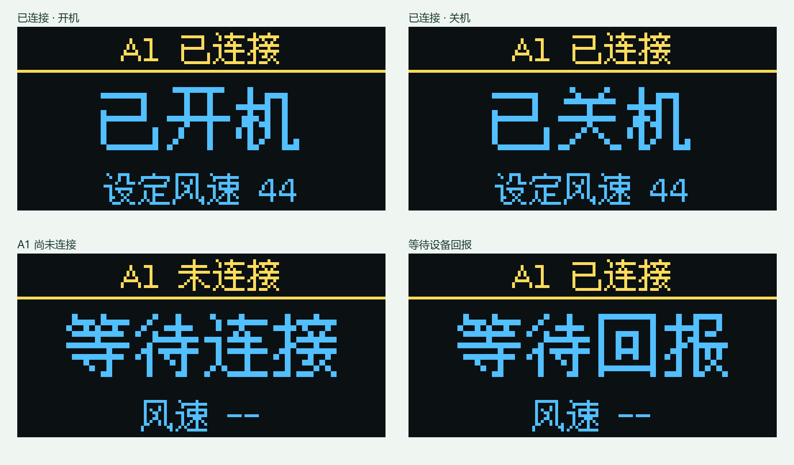
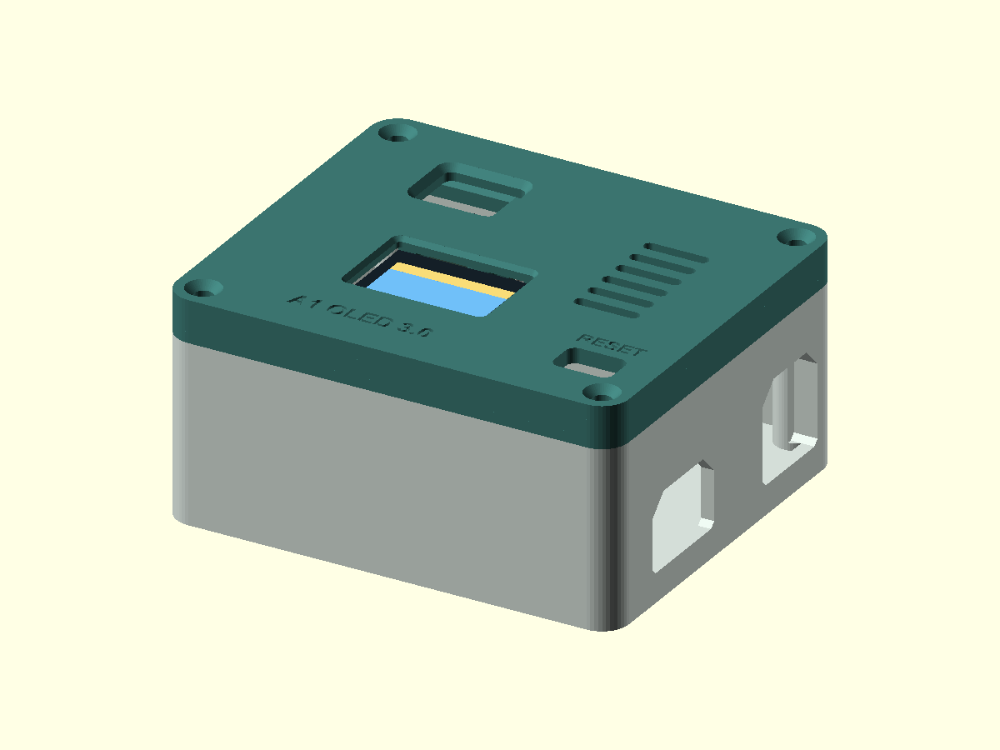

# A1 3.0 OLED 版｜接线、编译、配网、打印与验收

3.0 在 ESP32 独立遥控的基础上，增加四针 0.96 寸 128×64 OLED。屏幕只放三项：**连接状态、开关状态、风速设定**。手机网页继续负责模式、调速、配网和红外学习。配置完成后 ESP32 独立供电，运行时无需电脑或 Python。

当前版本是 **3.0.0-dev 预览版，机械修订 2 已由用户确认可安装**。已经完成程序、屏幕状态逻辑、打印模型及离线检查；屏幕控制器、实际显示方向和 A1 联机仍需按本文复测。1.0 和 2.0 源码及发行版继续保留。

首次使用者先按 [2.0 新手教程](esp32-standalone.md) 安装 Arduino CLI、ESP32 板卡支持和 PowerShell，再回到本页使用 **`firmware/a1_oled`** 目录编译 3.0。仓库不包含个人 `config.h`，首次运行构建脚本会生成本机密码和证书，不能直接跳过此步骤只编译 `.ino`。

**外壳试装更新（2026-11-07）**：旧盖已收到实装失败反馈：两个模块的孔能对齐，但 OLED 玻璃不能贴平，红外的 L 形针脚及杜邦插头被塑料顶住。当前图纸已做机械修订 2，保持孔位、底盒及固件，增加玻璃避让和插头走线空间。**2026-11-09，用户反馈“修正的盖子可以安装”**，据此确认当前修正盖子的机械安装结果；该反馈不替代 OLED 显示和 A1 联机测试。

图中四种状态使用固件相同的字体和绘制位置离线生成，颜色模拟黄蓝屏分区。实际字体为点阵字。

## 1. 接 OLED，保留红外接线

断开 ESP32 电源后接线。照片中 OLED 的针脚文字依次是 **VCC、GND、SCL、SDA**，请按这些文字逐根连接。若四个焊盘尚未焊排针，需要先焊好排针或导线，使连接可靠。

| OLED 丝印 | ESP32 接点 | 说明 |
| --- | --- | --- |
| VCC | 3V3 | 使用 3.3 V 供电 |
| GND | GND／G | 共地 |
| SCL | GPIO22／SCL22 | I²C 时钟 |
| SDA | GPIO21／SDA21 | I²C 数据 |

这块 ESP32 的 I²C 区域标有 SDA/21、SCL/22，可以按丝印找信号针。红外接收头继续使用 S→GPIO27、电源→3V3、负极→GND。OLED 与红外接收头共同使用 3V3 和 GND，各自接到主板上对应的电源针。

照片和标签表明屏幕是四针 I²C、128×64、黄蓝显示。固件先按常见的 **SSD1306** 驱动适配，自动探测 7 位地址 **0x3C、0x3D**。控制芯片尚未实物确认。若回家发现卖家说明是 SH1106，可在 [oled_settings.h](../firmware/a1_oled/oled_settings.h) 把 `OLED_USE_SH1106` 改为 `1` 后重编译；屏幕倒置可把 `OLED_ROTATE_180` 改为 `1`。

## 2. 编译与生成本机配置

进入仓库根目录，在 **PowerShell 7.2 或以上**操作。Arduino CLI 路径替换成自己电脑实际的路径。

首次编译要处理旧设备握手库和中文字库，耗时可能较长。请保留终端，等待最后的存储占用统计或明确的错误输出。

~~~powershell
$arduino = 'D:\Arduinocli\arduino-cli.exe'
& $arduino lib install 'IRremote@4.7.1' 'ArduinoJson@7.4.3' 'ESP_SSLClient@3.1.3' 'U8g2@2.36.19'
$buildPath = Join-Path $env:TEMP 'a1-oled-build'
~~~

构建输出路径需要使用纯英文字符。如果 Windows 用户名或临时目录包含中文，把上面的输出目录改成 `$buildPath = 'C:\A1Build\a1-oled'`。构建脚本会提前检查，避免在链接阶段才失败。

已经有 2.0 的本机 `config.h` 时，第一次在 3.0 目录生成配置可以用下面的命令。它沿用网页密码和本地证书，便于从 2.0 升级。若 3.0 的 `config.h` 已经存在，脚本会停止覆盖，直接执行后面的普通编译命令即可。

~~~powershell
& .\firmware\a1_oled\build.ps1 -PrepareOnly -ConfigFrom .\firmware\a1_standalone\config.h
& .\firmware\a1_oled\build.ps1 -ArduinoCli $arduino -BuildPath $buildPath
~~~

如果是第一次安装，没有任何本机配置，用待配置模式生成密码并编译。

~~~powershell
& .\firmware\a1_oled\build.ps1 -Unconfigured -ArduinoCli $arduino -BuildPath $buildPath
~~~

首次安装的板卡支持、A1 配网、固定 IP 和首次接入继续参考 [2.0 八步教程](esp32-standalone.md)。3.0 使用相同的 NVS 命名空间 `a1-local`。常规上传会沿用 Flash 内的家庭网络和已学红外键，升级时使用相同的 `esp32:esp32:esp32` 板型和分区。

## 3. 烧录、通电与手机配置

接好屏幕后，用 USB 数据线连接 ESP32，先用 `board list` 确认端口。下面的 `COM5` 换成实际端口。

~~~powershell
& $arduino board list
$port = 'COM5'
& $arduino upload -p $port --fqbn esp32:esp32:esp32 --build-path $buildPath --verify .\firmware\a1_oled
& $arduino monitor -p $port --config baudrate=115200
~~~

如果板子只有 RESET、自动下载失败，按 2.0 教程把 GPIO0 临时接 GND，按 RESET 再上传。校验完成后拔掉跳线，按 RESET 正常启动。串口会打印 OLED 地址，随后打印网页地址和网络服务状态。

- 看到 `OLED online: I2C 0x3C` 或 `0x3D`，说明总线上有设备应答。接下来观察显示内容是否正确，地址应答本身不能确认控制芯片型号。
- 看到 `OLED not found`，先断电核对 VCC/GND 与 SDA/SCL。屏幕未接或没有应答时，固件继续提供手机网页与红外控制，每 10 秒重试探测。
- 手机继续打开 ESP32 原来的 `http://固定IP:8080/`。页面新增 OLED 检测状态，便于排查。家庭 Wi-Fi、A1 和路由器在线后，等 A1 回报再测试。

第一次使用 `-Unconfigured` 编译的 ESP32，按以下顺序配置：

1. 记录构建脚本打印的网页登录密码，用户名是 `a1`。该密码也保存在本机 `config.h` 的 `WEB_PASSWORD` 中，不要把该文件上传或转发。
2. 手机连接 ESP32 的 `A1-Setup-xxxx` 热点，热点密码与网页密码相同，打开 `http://192.168.4.1:8080/`，输入用户名和密码。
3. 填写自己的家庭 **2.4 GHz Wi-Fi**、路由器地址、ESP32 预留 IP、A1 的 IP 和完整 MAC。不要照抄其他人的地址；A1 尚未联网或不知道这些信息时，先按 [2.0 教程](esp32-standalone.md) 完成 A1 配网和路由器 IP 预留。
4. 保存并等待 ESP32 重启。手机切回家庭 Wi-Fi，打开 `http://ESP32预留IP:8080/`，使用同一组网页登录信息。
5. 首次接入 A1、路由器 DNS 设置及网页连接失败时的 `connect-a1.ps1` 操作，继续按 [2.0 教程](esp32-standalone.md) 完成；3.0 的接入协议与其相同。
6. 等网页收到 A1 回报后再测试开关和风速。需要实体遥控时，在手机网页完成红外按键学习。OLED 会跟随设备回报，不会把尚未确认的指令当作已执行。

升级用户保留原 NVS 配置时，可继续使用原来的 ESP32 网页地址；不必为了安装 OLED 而重新配网。电脑关机测试前，给 ESP32 接独立 USB 电源，保持路由器、A1 和手机处于同一家庭网络。

## 4. 屏幕怎么看

| 状态 | 屏幕内容 |
| --- | --- |
| 家庭 Wi-Fi 尚未连接 | 「Wi-Fi 连接中／等待联网」，风速为空 |
| 等待手机完成配网 | 「配置网络／待配网」 |
| Wi-Fi 已连，A1 未连 | 「A1 未连接／等待连接」，风速为空 |
| A1 刚连接，尚未回报 | 「A1 已连接／等待回报」，风速为空 |
| A1 已回报 | 上方连接，中间大字「已开机／已关机」，下方「设定风速 44」等 |
| 已发指令，正在等 A1 确认 | 上方显示「A1 等待确认」，主状态保留最近的实际回报 |
| A1 或 Wi-Fi 断开 | 切回等待提示，隐藏此前的开关和风速 |

「设定风速」是原厂协议的 `30–85` 设定值。A1 关机后仍可能回报此前的设定值，所以显示为「已关机／设定风速 44」是合理的。屏幕每秒刷新一次。模式和红外学习操作放在手机网页上。

## 5. 3D 打印与装配

图纸目录是 [hardware/a1_oled_enclosure](../hardware/a1_oled_enclosure/)。**底盒沿用原来高 33 mm 的 M3 版本，不改孔、不改接口、不用重打。** 额外的 5 mm 空间全部放到新盖子的中空围边上，盖顶厚 2.8 mm。合盖外廓仍为 **84 × 73 × 40.8 mm**，其中盖子外部高度为 7.8 mm，另有伸入底盒的定位边。

本次同时纠正了第一版盖子的翻面方向。新 STL 已在打印坐标中做前后镜像，装配预览用实体可实现的 180° 旋转翻面，避免预览正确而实物文字和 RESET 位置相反。**切片时不要再做镜像。** 第一版修正平盖见 [a1_ir_lid_corrected](../hardware/a1_ir_lid_corrected/README.md)，不装 OLED 时可单独换这个盖子。

| 文件 | 用途 |
| --- | --- |
| [a1-base-and-oled-lid-v3.stl](../hardware/a1_oled_enclosure/a1-base-and-oled-lid-v3.stl) | 当前单文件打印入口，包含原 M3 底盒和修正 OLED 盖；两件平放，间隔 8 mm，单位 mm |
| [a1-base-m3.stl](../hardware/a1_oled_enclosure/a1-base-m3.stl) | 原来的 33 mm M3 底盒，文件与原版完全相同；已有底盒不用重打 |
| [a1-lid-oled-v3.stl](../hardware/a1_oled_enclosure/a1-lid-oled-v3.stl) | 适配原底盒，带 5 mm 围边、OLED 窗口和红外窗口；已纠正镜像 |
| [a1-oled-fit-check.stl](../hardware/a1_oled_enclosure/a1-oled-fit-check.stl) | OLED 窗口与四个安装位的小试装件，建议先打印 |
| [a1-fit-check-m3.stl](../hardware/a1_oled_enclosure/a1-fit-check-m3.stl) | 主板孔位和 USB 插头试装件 |
| [a1-oled-enclosure.scad](../hardware/a1_oled_enclosure/a1-oled-enclosure.scad) | 可编辑图纸 |

OLED 按常见 **27.3 × 27.8 mm PCB、23.3 × 23.8 mm 孔距**建模，照片中的实物尚未用卡尺复核。窗口 **25.6 × 17.6 mm**，四个安装位可小幅纵向调整。先打印 OLED 小试装件，再试放屏幕，确认黑色玻璃、四个孔和排针都能放好。屏幕板尺寸或显示区偏移不同时，修改源文件顶部的 `oled_pcb`、`oled_pitch`、`oled_window` 等参数后重导出。

修订 2 保持已确认能对齐的安装孔及前侧窗口不变，盖内新增 **27.2 × 19.6 mm、深 1.0 mm 的玻璃避让槽**，并清掉四个安装座靠玻璃一侧的干涉。红外安装面向盒内加深 **4 mm**，支架高度从 4.1 改为 8.1 mm；左侧定位边增加局部走线缺口，给原有 L 形针脚和杜邦插头留空间。新盖 STL 总包络高 10.9 mm，包含伸入底盒的支架，合盖外部尺寸仍是 84 × 73 × 40.8 mm。

交付 STL 使用二进制格式。修改源文件后，也建议用 OpenSCAD 命令行的 `--export-format binstl` 导出，保留坐标精度。设 `-D 'part="lid"'` 导出完整上盖，设 `-D 'part="oled_fit"'` 导出 OLED 小试装件。

上盖外表面贴打印板、内侧围边和柱子朝上。建议 0.4 mm 喷嘴、0.2 mm 层高、3 道外墙、缩放 100%，不再镜像。主板原来的 **M3 × 12 mm + 4 mm 尼龙隔柱 + 螺母垫片** 保持原样。3.0 加高盖用四颗 **M3 × 12 mm**，替换平盖原来的 M3 × 8 mm；先试拧，确认能贴合且螺丝不顶到底。OLED 用 **M2 × 5 mm** 螺丝和薄垫片固定在盖内四个柱上，发光面朝窗口，四针接口朝盒子后方。先松装，确认玻璃不受挤压后再固定。

红外板移到上盖后方窗口。线沿侧面走，避开 OLED 背面、螺丝柱和上盖定位边。图纸上电子件是装配示意，合盖前请实物检查杜邦头高度和 RESET 孔位置。

已打印底盒的用户只需试印修正盖子。桌面上的单个最终 STL 包含底盒、上盖两个独立零件，切片时拆分模型并只打印盖子即可。试装时先断电，确认 OLED 无需硬压即可贴平，再接回原来的 L 形插头，检查红外模块、插头和线都不顶盖，最后松装四角螺丝并试遥控收码。

## 6. 按顺序进行实物验收

1. 先接 OLED 在桌面通电，检查中文、黄蓝区、屏幕方向和串口地址。
2. 用手机测试开机和关机，确认 OLED 只在 A1 回报后改变开关状态。
3. 在手机改风速，确认屏幕数值与网页设备回报相同，再试原来的红外按键。
4. 断开 A1 的电源，观察屏幕是否切到等待连接。固件启用了 TCP 保活，突然断电的检测需要等待探测，通常为几十秒；请预留约一分钟观察，并在家确认实际耗时。重新上电后等它自动回报。
5. 确认功能后试装外壳，复测红外接收角度、USB 插头和散热。
6. 给 ESP32 独立供电，电脑关机，用手机和遥控器各试一次。

目前固件、128×64 离线绘制、状态逻辑及模型网格可在公司检查。OLED 的实际驱动兼容性、家庭网络自动重连、显示与真实 A1 同步、打印公差均留给以上实机验收。

## 7. 本次离线验证记录

2026-11-07 在 Windows 上，使用 Arduino CLI、ESP32 Arduino Core **3.3.12** 和上文所列的库版本，按 `esp32:esp32:esp32` 默认分区完成编译与链接。程序占用 **1,248,963 / 1,310,720 字节（95%）**；静态内存占用 **78,028 / 327,680 字节（23%）**。编译输出路径使用纯英文临时目录。

屏幕状态逻辑的本机 C++ 断言检查通过，覆盖配网、Wi-Fi 断开、A1 未连接、等待回报、开机、关机、等待确认和无有效风速等情况。页面 JavaScript 语法检查通过，原有 27 项 Python 测试通过。128×64 界面已用固件相同的字库离线绘制，核对文字位置。

旧盖曾通过网格、底盒和裸 PCB 的名义几何检查，但用户实装发现玻璃及 L 形插头仍被干涉，说明旧检查范围不足。当前修订 2 增加了玻璃和插头占用空间的检查，测试包络为校核假设，并非实物完整测量。检查记录见 [lid-only-verification.json](../hardware/lid-only-verification.json)，记录区分旧版实装失败与 2026-11-09 用户确认修正盖子可安装。固件编译结果沿用上述记录，机械修订没有改固件；真实 OLED 显示、A1 同步及其他打印机或模块的装配适配，继续按第 6 节验收。

参考资料包括 [U8g2 官方 API](https://github.com/olikraus/u8g2/wiki/u8g2reference)、[0.96 寸 OLED 模块说明](https://docs.particle.io/assets/datasheets/makerkit/oled.pdf) 和 [Espressif TCP 保活接口](https://docs.espressif.com/projects/esp-idf/en/v5.5/esp32/api-guides/lwip.html)，同类模块资料用于选择驱动和初始尺寸。
