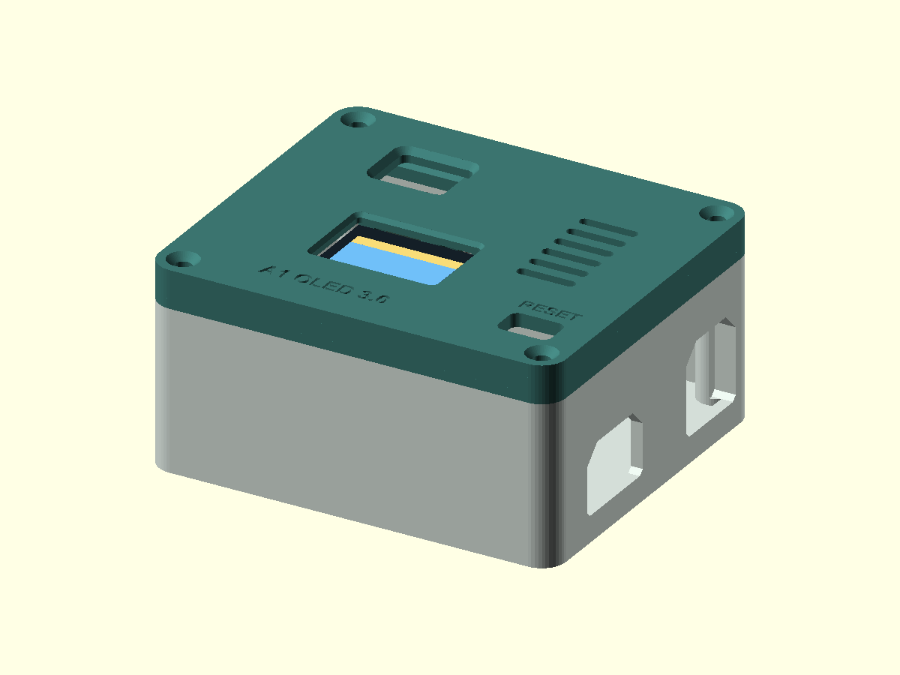

# 外壳与 3D 打印模型

## 当前 3.0 OLED 盖：机械修订 2，用户已确认可安装

沿用原来的 **33 mm 高 M3 底盒**，只更换 OLED 盖。旧盖曾出现 OLED 玻璃不能贴平、红外 L 形针脚和杜邦插头被顶住的问题。当前修订保持安装孔、文字方向和 RESET 位置，增加 **1.0 mm 深的玻璃背面避让**，将红外支架向盒内加深 **4 mm**，并在定位边增加走线缺口。

| 需要做什么 | 文件 |
| --- | --- |
| 下载一个 STL，同时放置底盒与盖子 | **[a1-base-and-oled-lid-v3.stl](a1_oled_enclosure/a1-base-and-oled-lid-v3.stl)** |
| 已有底盒，只打印 OLED 盖 | [a1-lid-oled-v3.stl](a1_oled_enclosure/a1-lid-oled-v3.stl) |
| 第一次打印，需要原 M3 底盒 | [a1-base-m3.stl](a1_oled_enclosure/a1-base-m3.stl) |
| 先核对屏幕安装位置 | [OLED 小试装件](a1_oled_enclosure/a1-oled-fit-check.stl) |
| 自己调整尺寸 | [OpenSCAD 源文件](a1_oled_enclosure/a1-oled-enclosure.scad) |

单文件 STL 内有两个独立零件，已平放、间隔 8 mm，总占地 **84 × 154 mm**。单位为 **mm**、缩放 **100%**，已修正打印镜像，**不要再次镜像**。已有底盒的用户应只打印新盖；如果导入的是单文件模型，先在切片器中拆分，再移除底盒这一件。重新下载后要重新导入，避免继续切片旧模型。

3.0 盖用四颗 **M3 × 12 mm**；OLED 和红外模块固定使用 **M2 × 5 mm**。接线、装配和验收按 [3.0 教程](../docs/oled-3.0.md) 操作。二进制 STL 已做闭合网格及名义玻璃、插头空间检查。**2026-11-09，用户反馈“修正的盖子可以安装”**，当前机械修订 2 据此记录为可安装；OLED 显示和 A1 联机测试状态另见固件教程。

## 不装 OLED 的早期平盖

[红外平盖镜像修正版](a1_ir_lid_corrected/README.md)继续保留，可选用于同一原底盒。它是早期机械平盖的修正版，与软件的 1.0、2.0 版本号不是同一套编号。

## 下载校验

[SHA256SUMS.txt](SHA256SUMS.txt)列出 STL 模型的 SHA-256，可用 PowerShell `Get-FileHash -Algorithm SHA256 文件名` 对照。名义几何检查与实装反馈见 [lid-only-verification.json](lid-only-verification.json)。
